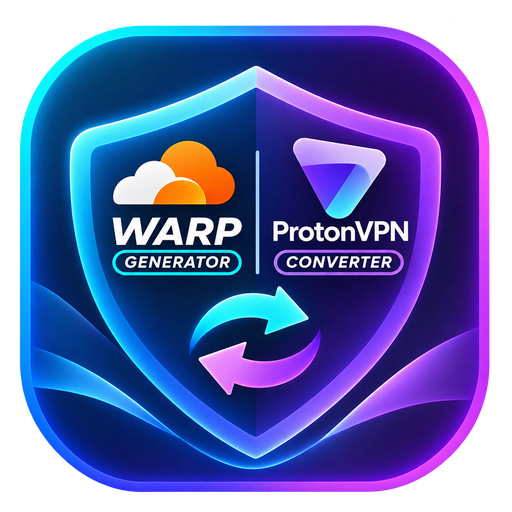

# WARP + Proton AWG

**WARP Generator & ProtonVPN Converter** — приложение для Android и Windows, предназначенное для генерации конфигураций Cloudflare WARP и преобразования профилей Proton VPN в форматы AmneziaWG, WireSock, Clash и Xray.

Приложение позволяет настраивать сетевые параметры, маршрутизацию и маскировку трафика, просматривать, копировать и экспортировать готовые конфигурации. Для подключения используется отдельный совместимый VPN-клиент.

Приватные ключи генерируются или обрабатываются локально. WARP-аккаунт хранится в памяти текущего сеанса, а конвертация профилей Proton VPN выполняется офлайн. Экспортированные конфигурации содержат приватные ключи.

## WARP — создать конфигурацию

Выберите формат и нажмите **Сгенерировать**. При первом запуске генератор создаёт пару ключей X25519 на устройстве, регистрирует публичный ключ через API Cloudflare и получает адреса туннеля и ключ сервера. Пока вкладка открыта, можно менять формат и настройки для того же аккаунта. Кнопка **Новый аккаунт** сбрасывает текущий результат. Следующая генерация выполнит новую регистрацию.

| Формат | Содержимое файла |
| --- | --- |
| AmneziaWG · `.conf` | Три варианта AWG 2.0 — готовый QUIC-пакет, QUIC со своим или случайным доменом SNI и SIP. Дополнительно доступны параметры AWG 3.0 и переключатели AWG 3.1 |
| WireSock · `.conf` | Домен имитации `Id`, протокол `Ip` (QUIC или DNS) и профиль `Ib` (Chrome, Firefox или cURL) |
| Clash · `.yaml` | Три профиля WireGuard с разными наборами пакетов, группа выбора `WARP` и правило `MATCH,WARP`. Все три используют `162.159.192.1:4500`. Нужен клиент с поддержкой `amnezia-wg-option` |
| Xray · `.json` | WireGuard-выход через `noise-out`, локальные входы SOCKS на `127.0.0.1:10808` и HTTP на `127.0.0.1:10809`. Для начального пакета можно задать домен |

**Сетевые параметры.** Можно выбрать DNS из шести наборов (Cloudflare, Google, dns.malw.link, xbox-dns.ru, geohide.ru и dns.comss.one), переключить IPv6, задать MTU, включить PersistentKeepalive и отключить мусорные пакеты. Для AmneziaWG, WireSock и Xray доступны случайный endpoint из встроенного списка, фиксированный `engage.cloudflareclient.com:2408` или свой адрес и порт.

**Маршруты.** В AmneziaWG и WireSock можно направить через туннель весь трафик, исключить локальную сеть или выбрать сервисы. Генератор заполняет `AllowedIPs` по встроенным спискам IP. Доступны YouTube, Discord, WhatsApp, Telegram, X (Twitter), Instagram, Facebook, Viber, Itch.io, RuTracker, Rutor, NNMClub, BestChange, AnimeGo и HDrezka.

**Регистрация WARP.** Доступны прямое подключение (Direct), локальный SOCKS5-прокси (127.0.0.1:10808) и встроенный ByeDPI с автоматическим подбором стратегии. В настройках ByeDPI можно включать и отключать готовые стратегии, добавлять собственные, менять таймаут проверки и запоминать успешную стратегию. На Windows нативный ByeDPI пока экспериментальный; Linux-специфичные параметры `md5sig`, `drop-sack` и `wait-send` не поддерживаются. Эти настройки относятся только к регистрации WARP.

## Proton — преобразовать готовые конфиги

Нажмите **Выбрать .conf**, чтобы открыть один или несколько файлов, либо **Вставить текст**, чтобы добавить конфиг из буфера. Конвертер работает офлайн и обновляет предпросмотр при изменении параметров.

- **Импорт.** Из секции `[Interface]` нужны `PrivateKey` и `Address`, из первого `[Peer]` — `PublicKey`, `Endpoint` и `AllowedIPs`. Конвертер учитывает DNS, IPv4/IPv6, необязательный `PresharedKey` и имеющиеся параметры маскировки. Если один файл неполный, рядом с результатом появится его имя и причина пропуска. Остальные файлы обрабатываются.
- **Пакетный экспорт.** AmneziaWG и WireSock получают по одному `.conf` на исходный профиль, Xray — по одному `.json`. Для Clash все профили собираются в один `clash-config.yaml` с группами выбора `Proton` и `Other` по именам серверов. Для Xray создаются локальные входы SOCKS и HTTP на портах 10808 и 10809.
- **Маскировка.** Для `Jc/Jmin/Jmax` есть пресеты `3/1/3` и `30/10/30`, ручной ввод, случайные значения и отключение через `Jc = 0`. Для AmneziaWG и Clash доступны поля `I1–I5`. Можно выбрать случайный встроенный пакет или сгенерировать QUIC-пакет `I1` по домену. Xray использует `I1` и параметры шума. Для WireSock задаются домен `Id`, протокол `Ip` и профиль `Ib`.
- **Сеть.** Сохраняется хост исходного endpoint, а порт выбирается в интерфейсе. Доступны 80, 88, 443, 500, 1194, 1224, 4500, 4569, 5060 и **51820 по умолчанию**. Можно задать MTU и PersistentKeepalive. Для AmneziaWG и WireSock доступно исключение LAN.

### Расширенные параметры AWG

Вкладки WARP и Proton позволяют вручную задать или случайно заполнить шесть диапазонов AWG 3.0. Это `ContentPaddingAddition`, `MaxHandshakeAttempts`, `KeepaliveTimeout`, `RejectAfterTime`, `RekeyAfterTime` и `RekeyTimeout`.

В WARP эти параметры доступны для AmneziaWG и Clash, а в режиме AWG 3.1 отдельно переключаются `RandomTrailers` и `DisableCookies`. В Proton параметры AWG 3.0 и переключатель `DisableCookies` доступны для AmneziaWG, WireSock и Clash.
